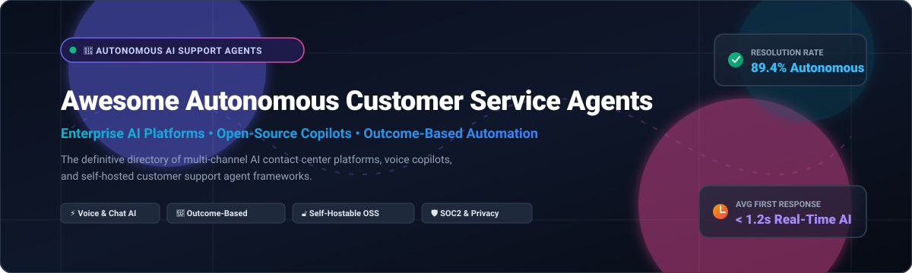

# Awesome-Autonomous-Customer-Service-Agents

# Awesome-Autonomous-Customer-Service-Agents 🤖 🎧

  

  

  

  

  

  

  

---

## 🌟 Top Autonomous Customer Service Agents Ecosystem

**Curated List of Commercial AI Customer Service Platforms & Open-Source Support Agent Frameworks**  

*Focused on Autonomous Resolution, AI Agents, Outcome-Based Pricing, Multi-Channel Support, Agent Copilots & Self-Hosted Support Automation*

**Last updated: October 2026** 📅

---

### 📌 Overview & SEO Summary

Welcome to the ultimate curated directory of **autonomous customer service agents**, **open-source support automation frameworks**, and **AI-powered contact center platforms**. Whether you are looking for enterprise-grade commercial solutions (such as *Salesforce Agentforce Service*, *Intercom Fin*, and *Sierra AI*), or self-hostable open-source alternatives (like *Klio Support Agent*, *Chatwoot*, and *Dify*), this list covers category leaders, outcome-based pricing, and privacy-respecting customer service automation.

**Key Market Context:**

- **ISG's 2026 AI Self-Service Buyers Guide** ranked **NiCE, Verint, and Salesforce as overall Leaders**, with **Content Guru, Dialpad, Five9, Genesys, Microsoft, RingCentral, Salesforce, Sprinklr, Talkdesk, Verint, Zendesk, and Zoom rated Exemplary** .

- **Salesforce's Help Worker Solution** uses **purely outcome-based pricing** — **400 Flex Credits per resolution**, charged only when the worker successfully resolves a query or request (not discarded sessions, negative feedback, or pre-feedback escalations) .

- **Intercom Fin** charges **$0.99 per outcome** with **no seat costs, no setup fees, and no platform fees** — an outcome is counted when a customer confirms resolution, doesn't ask for more help, or Fin completes a workflow .

- **Sierra AI** publishes **no pricing page, no rate card, and no per-outcome rate** — every commercial term including the definition of "resolved" is negotiated directly .

- **Decagon** requires a **$50,000/year platform fee** before any usage costs, with **per-conversation or per-resolution pricing** estimated at **~$0.99 per conversation** .

- **Parloa** uses **consumption-based pricing** — **per minute for voice and per interaction for chat**, with rates reflecting the complexity of each use case .

- **Ada CX** starts at **$33,000/year for 60,000 conversations** (AWS Marketplace), with implementation expenses ranging from **$15,000 to $100,000+** .

- **Forethought** blends **platform access fees with outcome-based pricing**, with implementation costs of **$10,000–$50,000+** and annual price escalators of **3–7%** .

- **Freshservice Freddy AI** offers **500 free AI sessions** with Growth, Pro, and Enterprise plans, then charges **$49 per 100 sessions** — a session is a **24-hour window** for chat or a **72-hour window** for email .

---

## 📑 Table of Contents

- [🏢 SaaS & Commercial Platforms](#-saas--commercial-platforms)

- [🔓 Open-Source GitHub Projects](#-open-source-github-projects)

- [🛠️ How to Contribute](#%EF%B8%8F-how-to-contribute)

- [📊 Star History](#-star-history)

- [🤝 Support & Sponsorship](#-support--sponsorship)

- [⚠️ Disclaimer](#%EF%B8%8F-disclaimer)

---

## 🏢 SaaS / Commercial Platforms

The autonomous customer service agent market spans **CRM-native platforms** (Salesforce Agentforce Service) that integrate **deeply with Service Cloud and CRM data**, **AI-native support platforms** (Intercom Fin, Sierra AI, Decagon) that focus on **autonomous resolution with outcome-based pricing**, and **enterprise contact-center AI** (Parloa, Cognigy, Cresta) that offer **voice and chat automation with consumption-based billing**. **Salesforce** was rated a **Leader in ISG's 2026 AI Self-Service Buyers Guide** . **Intercom Fin** charges **$0.99 per outcome** . **Decagon** requires a **$50,000/year platform fee** . **Parloa** charges **per minute for voice, per interaction for chat** .

> 💡 **Market Size & Structure:** The global AI customer service market is estimated at **~$15.12 Billion in 2026** (growing at a **23–27% CAGR** toward **$47B–$83B+ by 2030–2033**). The sector is **moderately to highly fragmented** rather than concentrated or winner-take-all, characterized by intense competition between legacy CRM incumbents (Salesforce, NICE, Zendesk), fast-scaling autonomous agent unicorns (Sierra, Decagon, Parloa), and specialized contact center platforms.

| SaaS / Commercial Platform | Company / Owner | Valuation / Market Cap | Pricing (Starting Tier / Basis) | Free Tier & Free Trial Limits | Description |
| :--- | :--- | :--- | :--- | :--- | :--- |
| **[Salesforce Agentforce Service](https://www.salesforce.com/service/)** ☁️ | Salesforce (NYSE: CRM) | ~$250 Billion | **400 Flex Credits per resolution** (~$2.00/res; $500 per 100k Flex Credits) or $125/user/month (Enterprise Service Cloud baseline) | **Salesforce Foundations: 200,000 Flex Credits included free**; 30-day trial with standard sandbox limits (no credit card required) | **CRM-native autonomous service** — Help Worker Solution uses outcome-based pricing: 400 Flex Credits only when the worker successfully resolves a query. Voice minutes billed per full minute; chat capped at 2 hours per resolution. ISG 2026 AI Self-Service Leader. |
| **[Sierra AI](https://sierra.ai/)** 🏔️ | Sierra | ~$15.8 Billion | **~$150,000/year platform fee** + **~$1.50 per resolved outcome** (blended conversation billing for triage) | **No free tier or public self-serve trial**; sales-guided POC demo on enterprise historical data | **Enterprise conversational AI** — Charges per resolved interaction. Sierra negotiates definitions of "resolved" directly with enterprise clients. Implementation: 3–7 months. |
| **[Cognigy.AI](https://www.cognigy.com/)** 🧩 | NICE (Acquired for $955M; NICE Market Cap ~$10 Billion) | ~$10 Billion (Parent NICE) | **$2,500/month** entry tier (~$115,000–$300,000+/year typical enterprise package) | **Trial environment (`trial.cognigy.ai`)**: Strictly rate-limited input quotas, request timeouts, and BYO API keys for generative LLM nodes | **Contact-center conversational AI** — Low-code conversational and agentic AI for voice and chat with deep contact-center DNA. Acquired by NICE to power CXone Mpower. |
| **[Decagon](https://decagon.ai/)** 🔷 | Decagon | ~$4.5 Billion | **$50,000/year platform fee** + **~$0.99 per conversation** (or per-resolution tier) | **No free tier or self-serve trial**; private sales evaluation & discovery prototype | **Enterprise AI support** — Per-conversation or per-resolution pricing. Integrates with Zendesk/Salesforce. Median ACVs range from $95,000 to $590,000+. |
| **[Freshservice Freddy AI](https://www.freshworks.com/freshdesk/)** 🔵 | Freshworks (NASDAQ: FRSH) | ~$3.6 Billion | **$49 per 100 AI sessions** (session = 24h chat or 72h email) + **$15/agent/month** (Freshdesk Growth) | **14-day to 21-day free trial**; includes a one-time allocation of **500 free Freddy AI sessions** across trial/paid plans | **AI-powered helpdesk** — Session defined as 24-hour window (chat) or 72-hour window (email). Freddy AI Agent Studio for omnichannel deflection. |
| **[Intercom Fin](https://www.intercom.com/)** 💬 | Salesforce (Acquired for $3.6B) | ~$3.6 Billion | **$0.99 per outcome** + **$29/seat/month** (Essential Plan) | **14-day free trial** with full Fin AI features (optional 7-day self-serve extension on day 13; no free-forever plan) | **AI-first customer service** — Outcome-based pricing: charged only when customer confirms resolution, doesn't ask for more help, or Fin completes a Procedure. Can be used standalone with zero Intercom seats. |
| **[Parloa](https://www.parloa.com/)** 🎯 | Parloa | ~$3.0 Billion | **Consumption-based: per minute for voice, per interaction for chat** (contracts typically start at ~$300,000/year) | **No free tier or public trial**; guided sales sandbox and custom contact-center demo | **Enterprise contact-center AI** — Rates reflect use-case complexity. One volume commitment across all channels. Agents improve and lower operating costs automatically. |
| **[Cresta](https://cresta.com/)** 🏢 | Cresta | ~$1.6 Billion | **$150,000/year for Voice** (up to 100k calls, $1.50/overage) or **$150,000/year for Chat** (up to 125k chats, $1.20/overage) | **No free tier or self-serve trial**; enterprise sales consultation and POC sandbox | **Enterprise AI contact center** — Real-time agent assistance, AI coaching, and end-to-end autonomous customer resolution with custom enterprise SLAs. |
| **[Ada](https://www.ada.cx/)** 🟢 | Ada | ~$1.2 Billion | **$33,000/year for 60,000 conversations** (AWS Marketplace starting tier) | **No free tier or self-serve trial**; sales discovery assessment and custom scoping | **Enterprise CX automation** — Conversation-based or resolution-based pricing. Enterprise platform packages frequently scale to $100,000–$300,000+ annually. |
| **[Forethought](https://forethought.ai/)** 🧠 | Zendesk (Acquired) | ~$117M (Prior total funding) | **$30,000–$40,000/year starting platform fee** (median spend $60,000–$75,000/year) + outcome resolution fees | **No free tier or self-serve trial**; formal "Proof of Value" (POV) pilot using historical ticket archives (min 20k tickets) | **AI support platform** — Solve, Assist, Triage, and Voice products. Acquired by Zendesk in 2026 and offered as Forethought AI Agents by Zendesk. |

---

## 🔓 Open-Source GitHub Projects

*Sorted by GitHub_Stars_Count (Descending)* 🌟

- **[Klio Customer Support Agent](https://github.com/klio-tech/customer_support_agent)**   

  **Open-source AI-powered customer support agent**, open-source. **Embeddable chat widget with single script tag** — Shadow DOM isolation, session persistence via localStorage, Markdown rendering, streaming responses, and identity passthrough . **Knowledge base with URL crawling (sitemap-aware) and document upload (PDF, TXT, CSV, JSON)** — documents chunked, embedded into 1536-dimension vectors, stored in PostgreSQL via pgvector, and retrieved via semantic similarity search . **Agent configuration via `agent.config.yaml`**: persona (name, system prompt, tone), model (300+ via OpenRouter, temperature), escalation rules (confidence threshold, keywords like "speak to human"), and widget branding (primary color, welcome message) . **Per-org agent config** allows each organization to customize prompts, model settings, escalation rules, and widget branding . **Webhooks for escalation, completion, and low-confidence events** . **The most complete open-source customer support agent with embeddable widget**. 🛠️

- **[Chatwoot](https://github.com/chatwoot/chatwoot)**   

  **Open-source customer engagement suite**, MIT licensed. **25K+ GitHub stars** — **the most widely deployed open-source support desk** . **Omnichannel: website, email, WhatsApp, Facebook, Instagram, SMS, and more** . **Custom attributes for segmentation and automation triggers** . **Self-hosted deployment for full data control** . **The foundation for customer communication during support automation**. 💬

- **[Dify](https://github.com/langgenius/dify)**   

  **LLMOps platform with agentic workflows**, Apache-2.0 licensed. **157K+ GitHub stars** — **visual drag-and-drop workflow builder** . **Built-in RAG pipelines and agent nodes** . **100+ LLM providers** . **Self-hosted or Dify Cloud** . **The most complete open-source LLM app builder for support automation**. 🎨

- **[n8n](https://github.com/n8n-io/n8n)**   

  **Workflow automation with AI capabilities**, Sustainable Use License. **176K+ GitHub stars** — **the most popular open-source automation platform** . **AI Workflow Builder with plain English prompts** . **400+ integrations** . **Self-hosted with unlimited executions** . **The "action layer" for AI support agents**. 🔄

- **[Zammad](https://github.com/zammad/zammad)**   

  **Open-source helpdesk and customer support system**, AGPL-3.0 licensed. **The most feature-complete open-source helpdesk** — ticket management, knowledge base, SLA management, and multi-channel support . **REST API and integrations** . **Self-hosted or Zammad Cloud** . 🎫

- **[Rasa](https://github.com/RasaHQ/rasa)**   

  **The leading open-source conversational AI framework**, Apache-2.0 licensed (core). **25M+ downloads** — **enterprise-grade on-premises deployment** . **Flows for business logic** . **CALM for LLM-powered assistants** . **Full data sovereignty** . 🏛️

- **[Botpress](https://github.com/botpress/botpress)**   

  **Open-source platform for building AI-powered chatbots**, MIT licensed. **Visual flow builder with built-in NLU** . **Multi-channel deployment** (web, WhatsApp, Slack, Telegram) . **Self-hosted option** . 🎨

- **[Zaturn](https://github.com/kdqed/zaturn)**   

  **AI Co-Pilot for data analytics and business insights**, open-source. **Just chat with your data — no SQL, no Python** . **Connects to PostgreSQL, SQLite, DuckDB, MySQL, ClickHouse, SQL Server, CSV, and Parquet** . **Generates visualizations** . **Usable as MCP or web interface** . 🤖

---

## 🛠️ How to Contribute

Contributions are welcome! Follow these steps to submit new autonomous customer service platforms or open-source support automation software:

1. 🍴 **Fork** the repository.

2. 📝 **Add/edit** entries in `README.md` maintaining table/list structure and formatting.

3. 🔗 Include project title, official website/GitHub link, exact Stars_Count, license, and brief description.

4. 🚀 Submit a **Pull Request** with a descriptive summary of your changes.

---

## 📊 Star History

---

## 🤝 Support & Sponsorship

If you find this autonomous customer service agents repository useful, please consider supporting the project:

- ⭐ **Star** this repository to increase visibility!

- 🔀 **Fork** and share with fellow support leaders, CX professionals, and open-source advocates.

- ☕ **Sponsor & Buy Me a Coffee**: Support ongoing open-source curation via the [GitHub Sponsor Dashboard](https://github.com/sponsors/ishandutta2007).

---

## ⚠️ Disclaimer

- This is a **community-curated** list — not exhaustive and not an endorsement. ℹ️

- **ISG's 2026 AI Self-Service Buyers Guide** ranked **NiCE, Verint, and Salesforce as overall Leaders**, with **Content Guru, Dialpad, Five9, Genesys, Microsoft, RingCentral, Salesforce, Sprinklr, Talkdesk, Verint, Zendesk, and Zoom rated Exemplary** . **Cresta and Sierra were rated as providers of Merit** .

- **Salesforce's Help Worker Solution uses purely outcome-based pricing** — **400 Flex Credits per resolution**, charged only when the worker successfully resolves a query or request . **Salesforce was also rated a Leader in ISG's 2026 AI Self-Service Buyers Guide** .

- **Intercom Fin charges $0.99 per outcome** with **no seat costs, no setup fees, and no platform fees** — and can be used with existing helpdesk (Salesforce, etc.) with **zero Intercom seats** . **Decagon requires a $50,000/year platform fee before any usage costs** . **Sierra AI publishes no pricing at all** . **Ada starts at $33,000/year for 60,000 conversations** .

- **Open-source support automation tools are not turnkey** — **Klio requires PostgreSQL with pgvector, Node.js, and an LLM provider API key** . **Chatwoot and Zammad require deployment and maintenance** . **Dify requires PostgreSQL, Redis, and a vector database** . **Always validate automation accuracy and escalation logic with a proof-of-concept** before production deployment. 🤖

---

  <b>Made with ❤️ for support leaders, CX professionals, and open-source customer service advocates.</b>

